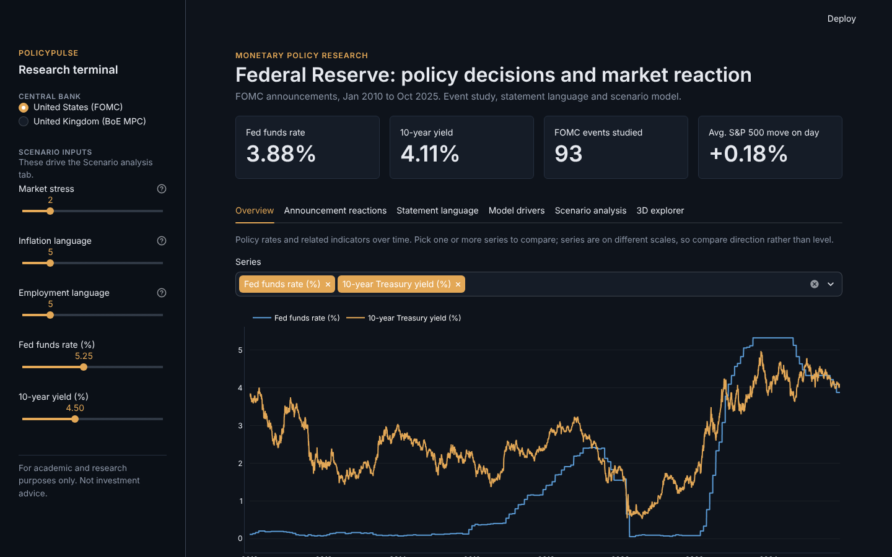
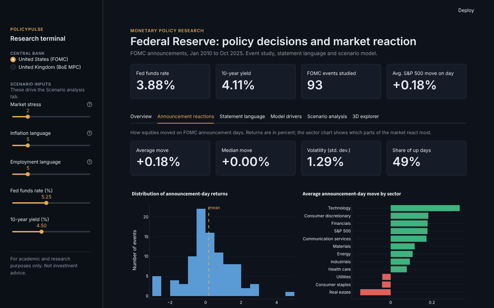
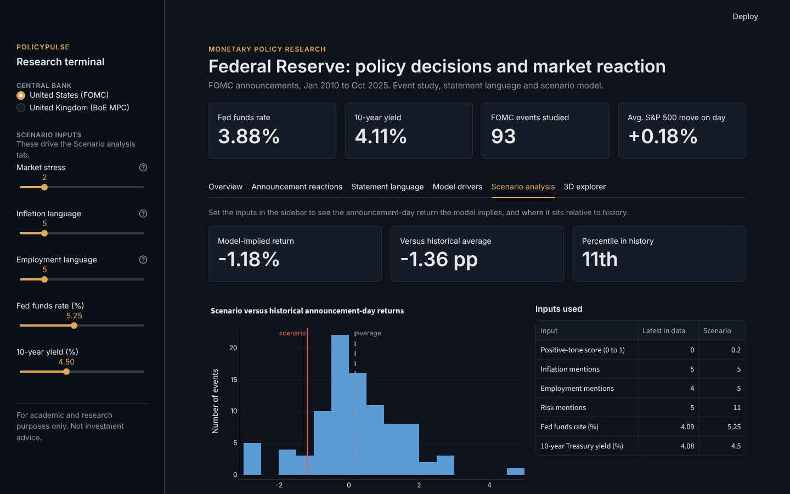
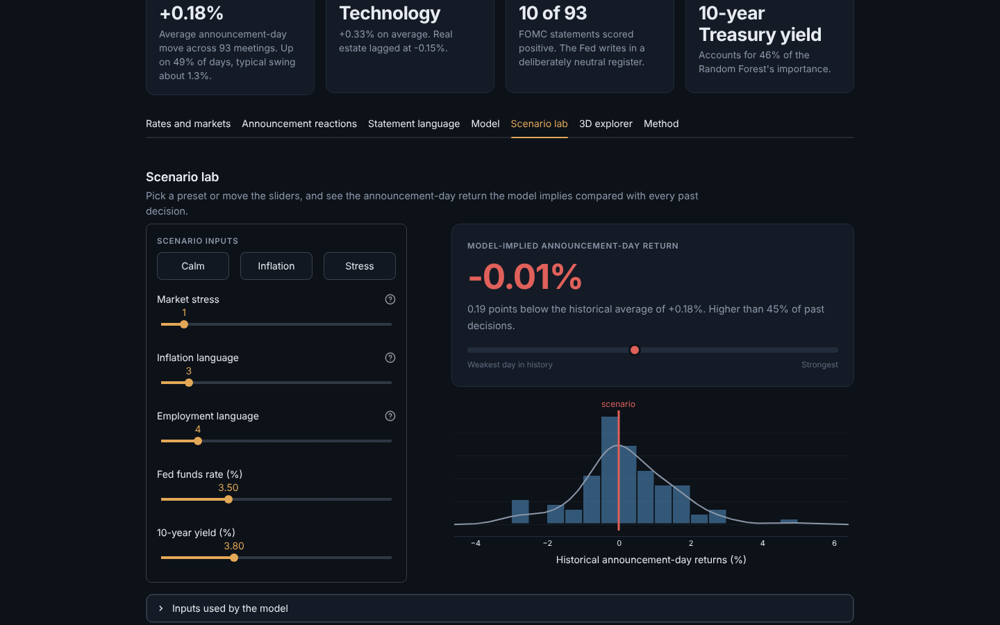
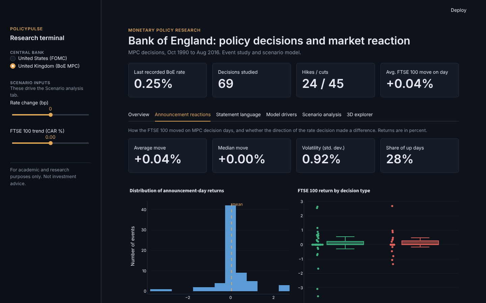

# PolicyPulse
**Global Monetary Policy Impact (GMP) Research Terminal**

> *Disclaimer: this project is for academic and research purposes only and does not constitute investment advice.*

PolicyPulse is an interactive research terminal that analyzes and simulates how **central bank policy decisions** move financial markets, combining event studies, NLP sentiment on policy statements, and machine learning.

**Live demo:** https://policypulse-devangi.streamlit.app/

---

## Screenshots



| Rates and policy regimes | Announcement reactions |
|---|---|
|  |  |

| Scenario lab (US) | United Kingdom view |
|---|---|
|  |  |

---

## Overview
The project studies how decisions by the **Federal Reserve (FOMC)** and the **Bank of England (BoE MPC)** affect equity markets and bond yields. It brings macroeconomic indicators, policy-text sentiment and market reactions into one analytical framework, organized as seven tabs:

1. **Rates and markets**: policy rates and yields over time, with major policy regimes shaded
2. **Announcement reactions**: announcement-day returns, their distribution, and sector or decision-type breakdown
3. **Statement language**: tone and topic emphasis of FOMC statements, and how tone relates to the market move
4. **Model**: which inputs the Random Forest relies on
5. **Scenario lab**: choose a preset or set inputs and compare the model-implied return with history
6. **3D explorer**: relate any three variables
7. **Method**: data, approach and limitations

## Key Features
- Event study framework (CAR and volatility around announcement windows)
- NLP sentiment scoring of central bank statements
- Random Forest model predicting market reaction
- Scenario analysis with sidebar inputs
- Interactive Streamlit dashboard with 2D and 3D Plotly charts

## Data Sources
- Federal Reserve Economic Data (FRED)
- FOMC policy statements (2010 to present)
- Bank of England policy rate data
- FTSE 100 market data (Yahoo Finance)

## Tech Stack
Python, Pandas, NumPy, Statsmodels, Scikit-learn, Plotly, Streamlit

---

## Run it locally
```bash
git clone https://github.com/devangi-agrahari/PolicyPulse
cd PolicyPulse
pip install -r requirements.txt
streamlit run gmp_global_app.py
```
The app reads the four CSV files in this repo, so no API keys are needed.

## Future Enhancements
- Expand coverage to additional central banks (ECB, BOJ)
- Intraday data for higher-frequency event analysis
- Finance-specific language models for sentiment
- Portfolio-level backtesting on policy signals

---

## Team
**Team project** by:

- **Devangi Agrahari**: MS in Finance, Quantitative Finance, University at Buffalo
- **Bhanu Teja Dunna**: MS in Finance, Quantitative Finance & FinTech, University at Buffalo

Original repository: https://github.com/Bhanu-Teja-Dunna/PolicyPulse
